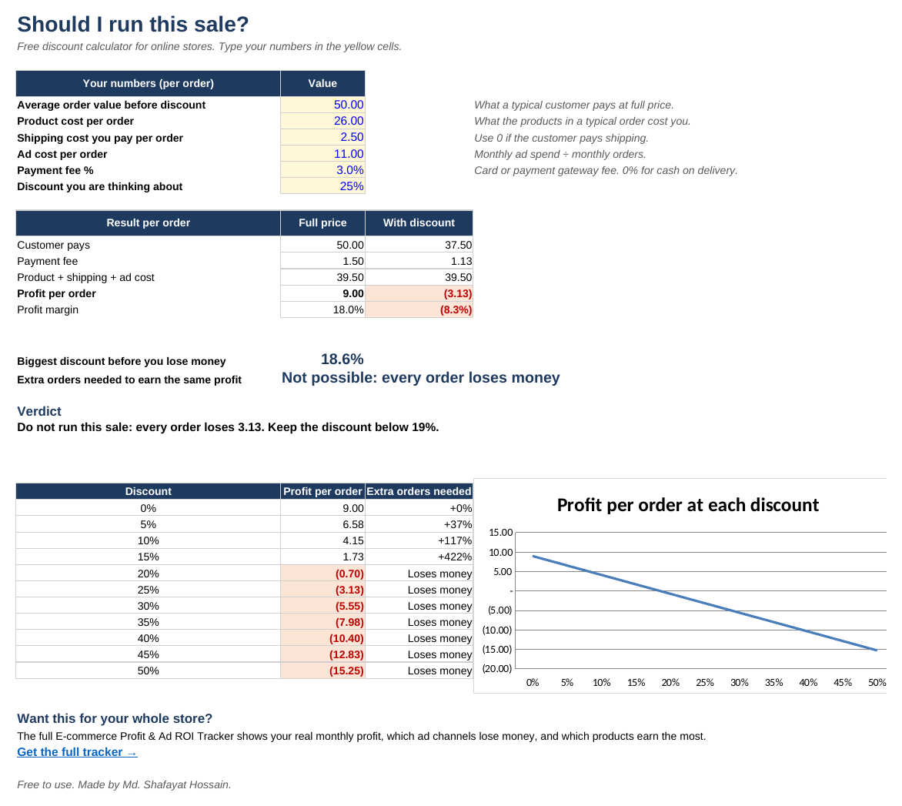

# Should I Run This Sale? Free Discount Calculator for Online Stores

**Before you run a 20%, 30% or 50% off sale, find out whether you will make money or lose it.**

Many online stores run discounts that look great on revenue and quietly lose money on every order. This free Excel calculator tells you, in under a minute:

- your **profit per order** at full price and with the discount
- the **biggest discount you can afford** before every order loses money
- how many **extra orders** you need just to earn the same profit
- a plain-English **verdict**: run it, risky, or don't



## How to use it

1. [Download `Free_Discount_Calculator.xlsx`](Free_Discount_Calculator.xlsx) (click **Download raw file** on the next page).
2. Open it in Microsoft Excel.
3. Type your numbers in the yellow cells: average order value, product cost, shipping, ad cost per order, payment fee and the discount you are planning.
4. Read the verdict and the table showing profit at every discount from 0% to 50%.

## Example

An order of $50 that costs $26 in products, $2.50 in shipping and $11 in ads earns **$9 profit** at full price.

| Discount | Profit per order | Extra orders needed |
|---|---|---|
| 10% | $4.15 | +117% |
| 15% | $1.73 | +422% |
| 20% | −$0.70 | loses money |

A 20% discount looks small, but this store would lose money on every order. The break-even discount is **18.6%**.

## How it works

```
Customer pays      = order value × (1 − discount)
Profit per order   = customer pays × (1 − payment fee) − product cost − shipping − ad cost
Break-even discount = 1 − (product cost + shipping + ad cost) ÷ (order value × (1 − payment fee))
Extra orders needed = profit at full price ÷ profit with discount − 1
```

The last line is the one most store owners miss: when profit per order halves, you need **twice as many orders** just to stand still.

## Want this for your whole store?

This calculator is one sheet from the **[E-commerce Profit & Ad ROI Tracker](https://shafayat2.gumroad.com/l/ldaidr)**, an Excel template that shows:

- your real profit every month, after product costs, refunds, shipping, fees, ads and fixed costs
- which ad channels (Facebook, Google, TikTok...) make money and which lose it, with ROAS and cost per new customer
- which products really earn the most, with warnings for low margins and high returns

👉 **[Get the full tracker on Gumroad](https://shafayat2.gumroad.com/l/ldaidr)**

## About

Made by **Md. Shafayat Hossain**, data analyst. The same profitability methods are used in my portfolio projects:

- [E-commerce profitability, marketing ROI & retention analysis](https://github.com/Shafayat97/ecommerce-profitability-retention)
